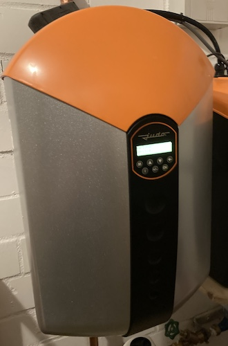

# JUDO i-soft SAFE+ integration for Home Assistant

Home Assistant custom integration to read and control the JUDO i-soft SAFE+ water softener via the myjudo.eu cloud. It is the version with the small character-lcd and leakage protection.

Unfortunately it is not possible to communicate directly with this version of the plant. Port 8000 and port 8124, through which the system can be read out on the Judo isoft-plus, are closed. The only way to access settings and data is via the cloud server.
To do this, you must register the system for the cloud service as described in the user manual and create a user account. There is also a judo smartphone app for this, but it is of course nicer to have everything in Home Assistant :-)

Notice:
There are 2 versions of the system, which sound very similar.
- i-soft safe+ (small display, leakage protection) --->This repo
- i-soft plus (large graphic display) ---> another tutorials, like this: https://blog.muwave.de/2017/06/monitoring-and-controlling-a-judo-i-soft-plus-water-softening-device-via-lan/

## Installation (Home Assistant integration)

Since version 3.0 this repository is a native Home Assistant integration.
AppDaemon, MQTT and the standalone Python script are **no longer required**.

### HACS (recommended)
1. HACS → three-dot menu → *Custom repositories* → add this repository URL, category *Integration*.
2. Install **JUDO i-soft SAFE+** and restart Home Assistant.

### Manual
Copy the folder `custom_components/judo_isoft_save_plus` into the `custom_components`
folder of your Home Assistant configuration (`/config/custom_components/…`) and restart
Home Assistant.

### Setup
*Settings → Devices & services → Add integration → JUDO i-soft SAFE+*, then enter the
credentials of your myjudo.eu account. The device must be registered for the JUDO cloud
service (see user manual).

Options (*Configure* on the integration):

| Option | Default | Description |
|---|---|---|
| Polling interval | 30 s | How often myjudo.eu is polled |
| Notifications | on | Show new warnings/errors as persistent notification |
| Sodium check | off | Limit output hardness so the sodium limit is kept (8.2 mg/L per °dH) |
| Sodium raw water / limit | 10 / 200 mg/L | Values for the sodium check |
| Slider limits | 60 min / 3000 L/h / 500 L | Max. values of the leakage protection sliders |

## Entities

- Sensors: total water / soft water / hard water (m³, usable in the energy dashboard),
  consumption today / yesterday, water flow, salt range, raw water hardness,
  next maintenance, battery, number of regenerations, time since last regeneration,
  average regeneration interval, message (newest warning/error)
- Binary sensors: regeneration running, cloud connection
- Numbers: output hardness, salt stock, sleep mode (hours, 0 = off),
  max. extraction time, max. water flow, max. extraction quantity
- Switch: water lock (on = water supply closed)
- Select: holiday mode
- Button: start regeneration

Diagnostics (raw registers, credentials redacted) can be downloaded from the device page.

### Warnings and errors (replaces the MQTT `notify` topic)

Every new entry of the device fault memory fires the event `judo_isoft_save_plus_message`
with `message`, `type` (`w` = warning, `e` = error), `code`, `timestamp` and `id`:

```yaml
alias: JUDO message to Telegram
triggers:
  - trigger: event
    event_type: judo_isoft_save_plus_message
actions:
  - action: notify.ha_message
    data:
      message: "JUDO i-soft SAFE+: {{ trigger.event.data.message }}"
mode: queued
```

## Migration from the AppDaemon / MQTT version (history is taken over automatically)

1. **Stop the old bridge** (remove/disable the app in AppDaemon or
   `sudo systemctl disable --now getjudo.service`). Keep the MQTT integration running.
2. Install this integration and add it (*Add integration → JUDO i-soft SAFE+*).
3. After the login the integration searches the entity registry for the MQTT entities
   of the old bridge (DE and ENG names, also renamed entity IDs) and shows a preview:
   old entity → new entity, last value and whether long-term statistics exist.
4. Confirm *Take over history and statistics*. The new entities then get **exactly the
   entity IDs of the old ones**, so history, long-term statistics (energy dashboard,
   water statistics), dashboards and automations simply continue.
   The counters "consumption today/yesterday", "time since last regeneration" and
   "average regeneration interval" continue with the last values of the bridge.
5. The old MQTT entities and their device are removed, the retained MQTT discovery
   messages are cleared so they do not come back. Old history stays in the database.

Not transferable (different entity type): the regeneration *switch* (now a button and
a binary sensor) and the cloud connection *sensor* (now a binary sensor). Automations
using them must be adjusted, as well as automations on the old `notify` MQTT topic
(now an event, see above).

If the old bridge is still sending values, the setup refuses the takeover until it is
stopped. With several old bridges you choose the one belonging to the device; the
takeover is only offered for accounts with one device.

### Attention
**Don't post or publish your myjudo.eu credentials or token anywhere. They allow full access to the plant!**
The integration does not log the token, and diagnostics downloads redact the credentials.


### This Project based of informations from:
- https://blog.muwave.de/2017/06/monitoring-and-controlling-a-judo-i-soft-plus-water-softening-device-via-lan/
- https://forum.fhem.de/index.php/topic,115696.15.html
- https://knx-user-forum.de/forum/projektforen/edomi/1453632-lbs19002090-judo-i-soft-wasserenth%C3%A4rtungsanlage/page2
- https://myjudo.eu (Javascript-Files)

Many thanks to this guys!!! & special thanks to [Daniel](https://github.com/danielegger1) who did the Appdeamon implementation and testing.
